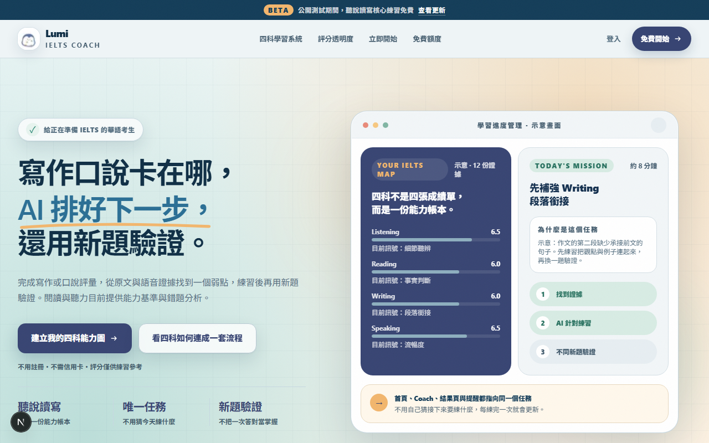
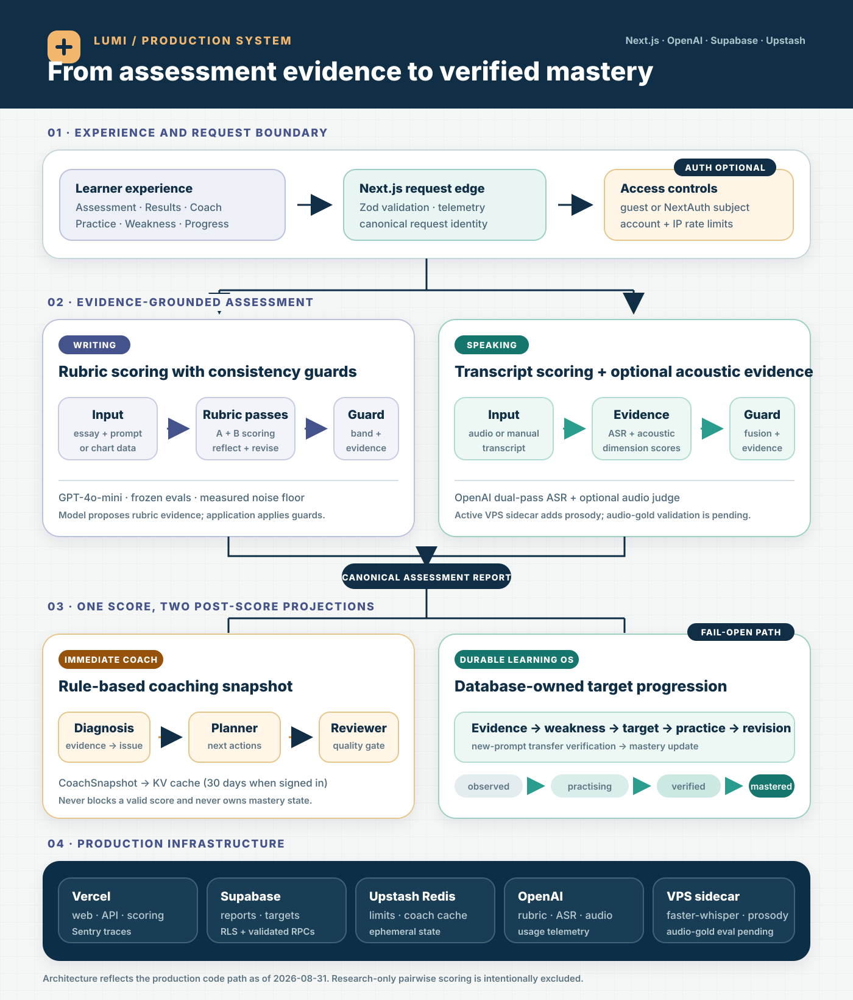

# Lumi — IELTS AI Learning Platform

Lumi is an IELTS Writing and Speaking practice platform with AI scoring, feedback, progress tracking, and coaching.

I built it because a useful scoring product needs to do more than return a band: it should explain the result, remember recurring weaknesses, and make scoring changes measurable.

[Live product](https://lumi.covenest.systems/)

## Learner journey



*Public landing-page test fixture from October 2026. Its values are illustrative; it contains no learner account data and is not scoring-quality evidence.*

1. A Writing or Speaking assessment presents a score with supporting evidence.
2. One priority weakness becomes a practice or revision task for an eligible signed-in learner.
3. A new prompt tests transfer; application and database rules decide when a target advances.

## Production architecture

<a href="./assets/lumi-production-architecture.svg">
  
</a>

The main boundaries are straightforward:

- Writing and Speaking use separate scoring pipelines.
- Scoring can work for guests; signed-in users also get persistent history and targets.
- Coaching is rule-based today and does not directly change mastery state.
- Durable learner state is stored in PostgreSQL and updated through validated server-side transitions.

Target progression:

```text
observed -> practising -> verified -> mastered
```

## Evaluation — July 2026 baseline

The first evaluation setup was not strong enough to support the accuracy claims I wanted to make, so I rebuilt the benchmark around official examiner-scored IELTS Writing samples.

The frozen set used for this July baseline contains 26 samples. Three anchor prompts are excluded from aggregate reporting, leaving 23 evaluation samples.

| Cohort | n | MAE | Within 0.5 band | Within 1.0 band | Spearman ρ |
|---|---:|---:|---:|---:|---:|
| All eligible samples | 23 | 0.826 | 43.5% | 82.6% | 0.778 |
| General Training + Task 2 | 17 | 0.765 | 58.8% | 82.4% | 0.826 |

Repeated no-change runs measured an approximate noise floor of **±0.011 Spearman** and **±0.044 MAE**. Changes smaller than roughly 0.02 Spearman or 0.05 MAE are treated as noise rather than improvement.

These figures predate an October 2026 anchor-loader repair. Later experiments used a different common subset, so this table should not be read as a fresh production accuracy measurement or compared directly with those experiments.

Speaking accuracy is intentionally not reported. The legacy Speaking anchors are synthetic and transcript-only, so they cannot validate pronunciation, acoustic fluency, or examiner agreement.

## Three engineering decisions

### 1. Rebuild the benchmark instead of defending it

Once I found that the earlier evaluation data could not support the claim I was making, I stopped using it and rebuilt the benchmark from official sources.

### 2. Measure evaluator variance before tuning

LLM scoring is stochastic. I first measured repeated-run variance, then required scoring changes to clear that noise floor before treating them as improvements.

### 3. Keep learning state outside the model

Model output can propose evidence, but progression is enforced by application and database rules. A valid score is never discarded because coaching or projection failed.

## Running in production

- Next.js 16 / React 19 / TypeScript
- OpenAI GPT-4o-mini for scoring
- Supabase PostgreSQL with Row Level Security
- Upstash Redis / Vercel KV for ephemeral state
- NextAuth for authentication
- Sentry plus structured cost, latency, and trace metadata
- Vercel deployment with an authenticated VPS acoustic sidecar for selected Speaking flows

This repository contains documentation and public-safe architecture assets only. Production source, prompts, credentials, and learner data remain private.
